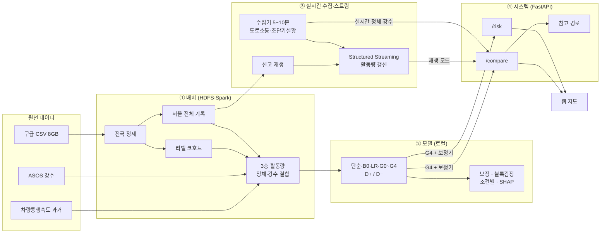
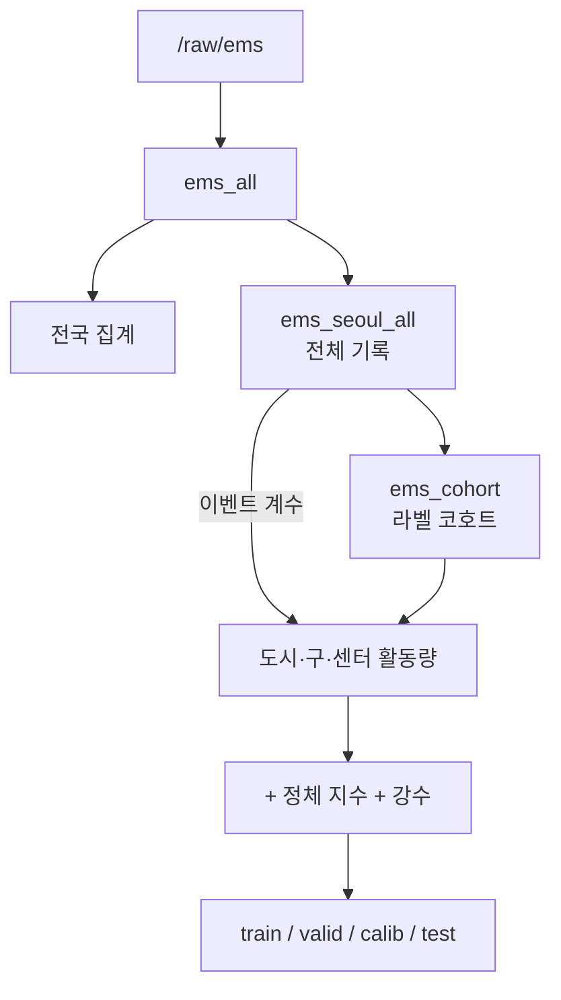
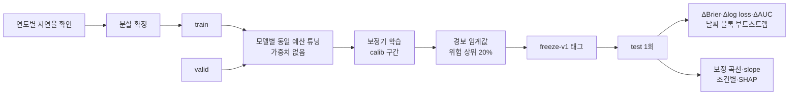
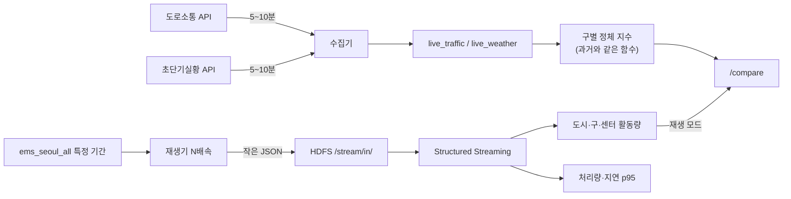
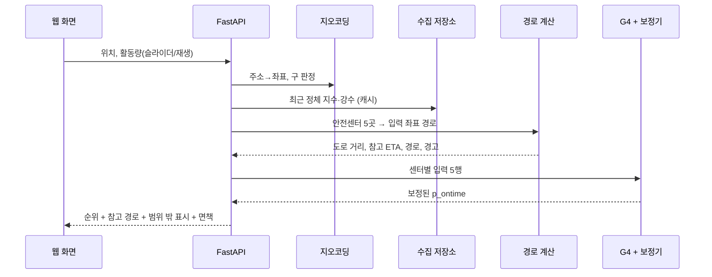
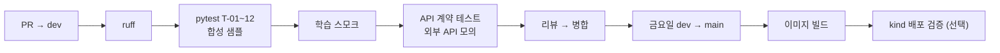

# 개발 아키텍처 — 서울 119 구급 8분 초과 위험 프로젝트

작성일: 2026-09-23 · 기준 문서: `01_기획서_v14.md`, `02_요구사항_명세서.md`

네 갈래로 나뉜다. **① 배치 처리**로 학습 데이터를 만들고, **② 모델 학습·평가**로 논문 결과를 얻고, **③ 실시간 수집·스트림**으로 Velocity 근거와 시스템 입력을 만들고, **④ 실시간 시스템**이 검증된 모델로 센터별 위험을 비교한다.

---

## 1. 전체 구조



---

## 2. 배치 처리

| 단계 | 입력 | 처리 | 출력 | 요구사항 |
| --- | --- | --- | --- | --- |
| 1. 적재 | 구급 CSV 7개 | HDFS 업로드 | `/raw/ems/{year}/` | FR-D-02 |
| 2. 변환 | `/raw/ems` | 문자열 읽기, `\N` 결측, 시각 0 채움·자정 보정, 연도 파티션 | `/clean/ems_all/` | FR-D-03 |
| 3. 전국 집계 | `ems_all` | 시도·연도별 8분 도착률 | `results/national_rate.csv` | FR-D-12 |
| 4. 서울 전체 기록 | `ems_all` | 서울 필터, `center_id`·`unit_type`, 복귀 일시 복원 (**정제하지 않음**) | `/clean/ems_seoul_all/` | FR-D-04~06 |
| 5. 라벨 코호트 | `ems_seoul_all` | 취소·결측·역전·180분 초과 제외 | `/clean/ems_cohort/` | FR-D-07 |
| 6. 3층 활동량 | 4 + 5 | 도시·구·센터 직전 60분 계수 | 중간 테이블 | FR-D-08 |
| 7. 정체 지수 | 속도 과거 자료 | 구·시간 평균 → 학습 기간 평소 대비 비율 | `speed_hist`, `speed_norm` | FR-D-10 |
| 8. 기상 | ASOS | 직전 정시 강수, 무강수·결측 구분 | 중간 테이블 | FR-D-09 |
| 9. 결합·분할 | 5~8 | 피처 결합, 연도 4구간 분할 | `data/splits/` | FR-M-01 |
| 10. 엔진 비교 | 원본·서울 | pandas vs Spark 같은 작업 3개 | `results/benchmark.csv` | FR-D-13 |



**핵심 규칙**: 활동량은 **4번(정제 전 전체 기록)**에서 세고, 라벨 평가는 **5번(코호트)**으로 한다.

---

## 3. 모델 학습·평가



- 모델 목록: 단순 기준, B0, LR, G0, G1, G2a, G2b, G3, G4 (+G5 조건부) × {D+, D−}
- 각 모델을 **같은 탐색 공간·같은 시행 횟수**로 각각 튜닝 (특정 모델 설정을 공유하지 않음)
- **최종 평가는 시스템 완성과 무관하게 수행**

---

## 4. 실시간 수집·스트림



- 수집기는 1주차부터 상시 가동(systemd·cron·컨테이너 중 택1), 실패·중단 로그 기록
- 스트리밍 체크포인트 `/stream/checkpoint/`, 재시작 복구 확인
- 배치 집계와 스트림 집계 비교 (FR-V-06)
- 재생은 과거 데이터를 다시 흘려보내는 부하 실험이며 실제 119 연계가 아님

---

## 5. 시스템

### 5.1 `/compare` 흐름



**입력 구성**: 지역 조건(정체 지수, 구 활동량)은 **구 단위**로 모든 후보에 동일하게 들어가고, 센터 간 차이는 **거리와 센터 활동량**이 만든다.

### 5.2 참고 경로

| 요소 | 구현 |
| --- | --- |
| 도로망 | OSMnx 서울 차량 도로망 (서버 시작 시 메모리 적재) |
| 간선 소요시간 | 길이 ÷ (도로 등급 기본 속도 × 해당 구 정체 지수). **실시간 링크 맵매칭은 범위 밖** |
| 긴급자동차 특례 | 일방통행 역방향 간선 추가 + 소요시간 × `contraflow_penalty` |
| 부적합 도로 | 보행로·자전거도로·서비스 도로 제외 |
| 불법주정차 (선택) | 경로 30m 버퍼 내 상습구역 수 |
| 검증 | 페널티 값별 경로 변화 민감도 (FR-S-06) |

### 5.3 학습·실시간 입력 일치

| 피처 | 학습 | 실시간 | 일치 방법 |
| --- | --- | --- | --- |
| 강수 | ASOS 108 직전 정시 | 초단기실황 RN1, 108 격자 | 같은 위치·1시간 누적 |
| 정체 지수 | 과거 속도 ÷ 평소 | 수집 속도 ÷ 같은 평소값 | `src/traffic` 공용 함수 (T-11) |
| 구 활동량 | 전체 기록 직전 60분 | 학습 중앙값 또는 스트림 | 같은 정의 |
| 센터 활동량 | 전체 기록 직전 60분 출동 | 슬라이더 또는 스트림 | 같은 정의 |
| 거리 (D+) | 대원 기재 정수 km | 도로 최단거리 반올림 | 차이는 한계로 기록, `out_of_range` 표시 |

---

## 6. 컨테이너·배포

| 서비스 | 포트 | 프로필 | 역할 |
| --- | --- | --- | --- |
| `namenode` / `datanode` | 9870 | pipeline, stream | HDFS |
| `spark-master` / `spark-worker` | 8080 | pipeline, stream | Spark (worker 4~6GB) |
| `jobs` | — | pipeline | 배치 작업 |
| `collector` | — | 상시 | 실시간 수집기 |
| `replayer`, `streaming` | 4040 | stream | 재생·스트리밍 |
| `api` | 8000 | app | FastAPI + 웹 |

```bash
docker compose --profile pipeline up -d
docker compose up -d collector          # 1주차부터 상시
docker compose --profile stream up -d
docker compose --profile app up -d
```

### Kubernetes 최소 배포 (FR-O-03)

```
k8s/
├── deployment.yaml   # api 이미지, replicas 1, readiness=/health
├── service.yaml      # NodePort
├── configmap.yaml    # 모델 경로, 캐시 주기
└── secret.yaml.example
```

```bash
kind create cluster --name ems
kind load docker-image ems-api:dev --name ems
kubectl apply -f k8s/
kubectl get pods && kubectl port-forward svc/ems-api 8000:8000
```

GitHub Actions에서 kind 클러스터를 만들어 `kubectl apply`까지 수행하면 FR-O-04 충족.

---

## 7. CI/CD



CI는 원본 데이터 없이 합성 샘플로만 동작한다.

---

## 8. 디렉터리 구조

```
ems-risk/
├── CLAUDE.md / AGENTS.md / README.md
├── docker-compose.yml, .env.example, pyproject.toml
├── k8s/                     # 최소 배포 매니페스트
├── configs/
│   ├── data.yaml            # 경로, 180분 기준, 관측소, 거리 상위 1% 기준
│   ├── features.yaml        # 활동량 창, 정체 지수 설정
│   ├── routing.yaml         # contraflow_penalty, 제외 도로
│   └── models/*.yaml        # b0, lr, g0, g1, g2a, g2b, g3, g4, g5
├── src/
│   ├── pipeline/   # A: 변환·서울 전체·코호트·활동량·분할
│   ├── benchmark/  # A: pandas vs Spark
│   ├── traffic/    # C: 정체 지수 (과거·실시간 공용)
│   ├── weather/    # C: ASOS, 초단기실황
│   ├── collector/  # C·D: 실시간 수집기
│   ├── models/     # B: 학습·보정·평가·블록 부트스트랩·조건별·SHAP
│   ├── spatial/    # C: 센터 좌표·도로망·참고 경로·주정차
│   ├── stream/     # D: 재생기·스트리밍·지표
│   ├── api/        # D: FastAPI·웹
│   └── common/
├── tests/ (fixtures/synthetic_10k.parquet)
├── results/ (커밋) · data/, models/ (.gitignore)
└── docs/ (01~05, DECISIONS, EXPERIMENTS, AI_USAGE_LOG, data_dictionary, data_terms)
```

---

## 9. 설정값

| 이름 | 위치 | 기본 | 용도 |
| --- | --- | --- | --- |
| `late_threshold_min` | data.yaml | 8 | 라벨 기준 |
| `error_cap_min` | data.yaml | 180 | 입력 오류 기준 |
| `dist_out_of_range_km` | data.yaml | (EDA 상위 1%) | 학습 범위 밖 표시 |
| `cbk_max_hours` / `cbk_min_coverage` | data.yaml | 12 / 0.9 | 복귀 복원, G5 조건 |
| `split_years` | data.yaml | 2019-22 / 2023 / 2024 / 2025 | 연도 민감도 후 확정 |
| `activity_window_min` | features.yaml | 60 | 활동량 창 |
| `cong_night_fill` | features.yaml | 1.0 | 정체 자료 없는 시간 |
| `contraflow_penalty` | routing.yaml | 1.5 | 역방향 페널티 |
| `excluded_highways` | routing.yaml | footway, cycleway, service, path | 제외 도로 |
| `collect_interval_sec` | .env | 300 | 수집 주기 |
| `traffic_cache_sec` / `weather_cache_sec` | .env | 300 / 600 | API 캐시 |
