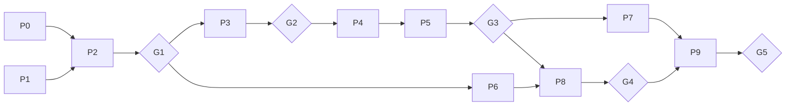

# 개발 진행표 — 데이터 확보부터 최종 제출까지

작성일: 2026-09-26 · 기준 문서: `01_기획서_v15.md`, `02_요구사항_명세서.md`, `04_개발_아키텍처.md`

위에서 아래로 진행한다. 각 작업은 **선행 작업이 끝나야 시작**하고 **완료 기준을 만족해야 끝**이다. 관문(G1~G5)에서 전원이 통과 여부를 확인한다.

**연구 트랙**(데이터 → 모델 → 최종 평가)과 **시스템 트랙**(수집·공간 → 스트림 → 웹 → 배포)은 3주차부터 병렬로 진행하며, **연구 트랙의 최종 평가는 시스템 완성을 기다리지 않는다.**

담당: A 최동혁(데이터·EDA), B 모델·평가, C 교통·기상·공간, D DevOps·서비스

---

## 0. 한눈에 보기

| 단계 | 주차 | 트랙 | 목표 | 관문 |
| --- | --- | --- | --- | --- |
| P0 환경·협업 | W1 | 공통 | 저장소, Docker, CI, Notion, **수집기 가동** | — |
| P1 데이터 확보·약관 | W1 | 연구 | 약관 확인, 원천 데이터 보관 | — |
| P2 품질 확인·EDA | W1–2 | 연구 | 데이터 사전, 품질 결론, EDA | **G1 (제안발표)** — 구급 데이터 부분 완료 |
| P3 배치 처리 | W3 | 연구 | 전체 기록·코호트·3층 활동량 | **G2** |
| P4 교통·기상 피처 | W3–4 | 연구 | 정체 지수, 강수 | — |
| P5 모델·평가 설계 | W4–6 | 연구 | 기준선·G1~G4, 보정, 검정 | **G3 (중간발표·동결)** |
| P6 공간·실시간 준비 | W3–6 | 시스템 | 센터 좌표, 도로망, 경로 규칙 | — |
| P7 최종 평가 | W7–8 | 연구 | 시험 구간 1회 평가 | — |
| P8 스트림·시스템·배포 | W7–8 | 시스템 | 재생 스트림, API, 웹, K8s | **G4** |
| P9 측정·논문·발표 | W9–10 | 공통 | 성능 측정, 소논문, 최종발표 | **G5** |

---

## P0. 환경·협업 (W1)

| # | 작업 | 절차 | 완료 기준 | 담당 |
| --- | --- | --- | --- | --- |
| 0-1 | 저장소 | 아키텍처 8절 구조, `.gitignore`, 문서 배치, 브랜치 보호 | 전원 clone | D |
| 0-2 | 개발 환경 | Python 3.11, 버전 고정 | 전원 `pytest` 실행 | D |
| 0-3 | Docker | pipeline 프로필(HDFS·Spark) | UI 접속, **3일 이내** | D |
| 0-4 | CI 기본 | ruff + pytest | 녹색 | D |
| 0-5 | Notion·역할 | 백로그, 칸반, 데일리 스크럼, **B·C·D 역할 확정** | 스크럼 기록 시작 | 전원 |
| 0-6 | API 키·제한 확인 | 카카오, 초단기실황, 도로소통. 호출 제한·이용 조건 | `.env.example`, `data_terms.md` | C |
| 0-7 | **실시간 수집기 가동** | 도로소통·초단기실황 5~10분 주기 수집, 실패 로그 | 24시간 연속 수집 확인 | C, D |

---

## P1. 데이터 확보·약관 (W1)

| # | 작업 | 절차 | 완료 기준 | 담당 |
| --- | --- | --- | --- | --- |
| 1-0 | **이용약관 확인** | 30일이 다운로드 기한인지 이용 기한인지, 팀 공유·CI 사용 가능 여부 | `docs/data_terms.md`, D-006 | A |
| 1-1 | 구급 현황 | 가입 → 무료 구매 → 다운로드 → 드라이브 보관 (**2024년부터**) | 크기 일치 | A |
| 1-2 | ASOS | 서울 108, 2019~2025 강수량 + 품질 표기 | `raw/asos/` | C |
| 1-3 | 차량통행속도 | 제공 형태·시간 범위 확인 후 다운로드 | `raw/speed/`, 범위 메모 | C |
| 1-4 | 안전센터 현황 | 공공데이터포털 15157581 | `raw/ref/` | C |
| 1-5 | 참고 자료 | 구급활동일지 서식, 8분 기준 문헌 원문 | `docs/refs/` | A |

---

## P2. 품질 확인·EDA (W1–2) — 제안발표 범위

서울 2024년으로 먼저 확인하고 결론을 전체에 적용한다.

| # | 작업 | 절차 | 완료 기준 | 담당 |
| --- | --- | --- | --- | --- |
| 2-1 | 전체 컬럼·인코딩 | 컬럼 목록 저장, 위치 관련 컬럼 재확인 | 컬럼 목록 | A |
| 2-2 | 로딩 규칙 | `\N` 결측 처리, 문자열 로딩 | T-09 초안 | A |
| 2-3 | 행 수 | 7개 파일 전국·서울 | `eda/row_counts.csv` | A |
| 2-4 | 서울 2024 추출 | `chunksize` + `usecols` | 로컬 Parquet | A |
| 2-5 | 시각 파싱 | `zfill(6)`, 자정 보정, 실패율 | 실패율 기록 | A |
| 2-6 | 조직 식별 | 동명 조직의 소방서 수, `center_id` 규칙 | D-003 초안 | A |
| 2-7 | 복귀 일시 | `cbk_ymd` 결측률, 복원 가능률 | D-004 초안 | A |
| 2-8 | 종결 구분 | `trmn_se_nm` 값별 건수 | 취소 비율 | A |
| 2-9 | 데이터 사전 | 컬럼·의미(서식 대조)·결측률·사용 여부 | `docs/data_dictionary.md` | A |
| 2-10 | EDA 11종 | 아래 표 | `eda/*.png` + 해석 문장 | A (+C) |
| 2-11 | 초기 결정 | D-001~D-007 | `DECISIONS.md` 3인 동의 | 전원 |

### EDA 항목

| 번호 | 그래프 | 쓰이는 곳 |
| --- | --- | --- |
| ① | 연도별 건수(전국·서울) | 5V Volume |
| ② | 도착시간 분포 + 8분선 | 선정배경 (8분 초과율) |
| ③ | 시간대 × 요일 초과율 | 선정배경 |
| ④ | 센터별 초과율 | 센터 단위 근거 |
| ⑤ | 센터 직전 60분 활동량별 초과율 | RQ1-b 근거 |
| ⑥ | 결측률 표 (`\N` 처리 후) | 5V Veracity |
| ⑦ | 강수 유무별 초과율 | 날씨 피처 근거 |
| ⑧ | 정체 시간대별 초과율 (속도 자료 확보 시) | RQ2 근거 |
| ⑨ | **연도별 8분 초과율** | **분할 구간 조정 (D-007)** |
| ⑩ | **거리 분포** | **학습 범위 밖 기준 (상위 1%)** |
| ⑪ | **구별 초과율·구 활동량별 초과율** | **RQ1-a 근거** |

시간이 부족하면 ② ⑤ ⑥ ⑨ ⑪을 우선한다.

### G1 관문 — 제안발표 (W2)

| 통과 조건 | 실패 시 |
| --- | --- |
| 이용약관 확인 완료 | 미확인 시 데이터 작업 보류, 교수님과 상의 |
| EDA 그래프와 해석 완성 | ② ⑤ ⑥ ⑨ ⑪ 우선 |
| 복귀 일시·조직 식별·거리 분포 결과 기록 | "확인 중"으로 발표, W3 재확인 |
| 차량통행속도 확보 가능 여부 | 불가 시 RQ2를 선택 항목으로 조정 |
| 수집기 24시간 안정 가동 | 주기 조정 또는 수집 항목 축소 |
| 재생 스트림·수집기의 Velocity 인정 여부, 생성형 AI 필수 여부 (교수님 확인) | 결과에 따라 5V·범위 조정 |

---

## P2 진행 결과

최신 상태는 `docs/progress/`의 가장 큰 번호 파일이 기준이다(규칙.md 10절). 이 표에 날짜 박힌 상태를 다시 적지 않는다. 제안발표 단계(G1) 기록은 `docs/progress/제안발표/`, EDA 상세 수치는 `06_EDA_결과.md` 참조.

## P3. 배치 처리 (W3)

| # | 작업 | 절차 | 완료 기준 | 담당 |
| --- | --- | --- | --- | --- |
| 3-1 | HDFS 적재 | 연도별 폴더 | 크기·파일 수 일치 | A |
| 3-2 | 변환 | 문자열·`\N`·시각 보정 → Parquet | 행 수 = 원본 | A |
| 3-3 | 전국 집계 | 시도·연도별 8분 도착률 | `national_rate.csv` | A |
| 3-4 | 서울 전체 기록 | 필터, `center_id`, `unit_type`, 복귀 복원 (**정제 안 함**) | 매핑 미스 0 | A |
| 3-5 | 라벨 코호트 | 명세서 3.3 규칙, 규칙별 건수 | `cleaning_log.csv` | A |
| 3-6 | 3층 활동량 | 도시·구·센터 직전 60분 계수 | T-02 통과 | A |
| 3-7 | 복귀 전 출동기록 | D-004 통과 시만 | T-10 통과 | A |
| 3-8 | 합성 샘플 | 가짜 1만 행 | CI 사용 가능 | A |

### G2 관문 (W3 말)

| 통과 조건 | 실패 시 |
| --- | --- |
| 코호트 + 3층 활동량 완성, T-01·02·09 통과 | 문제 연도 제외 후 진행 |
| 제외 비율·사유 보고 | 규칙 재검토 (D-002) |

---

## P4. 교통·기상 피처 (W3–4)

| # | 작업 | 절차 | 완료 기준 | 담당 |
| --- | --- | --- | --- | --- |
| 4-1 | 도로 → 구 매핑 | 속도 자료 도로를 구에 매핑 | 매핑표, D-005 | C |
| 4-2 | 구·시간 속도 | `speed_hist` | 결측 시간대 기록 | C |
| 4-3 | 평소 속도 | **학습 기간만**으로 `speed_norm` | 누출 없음 확인 | C |
| 4-4 | 정체 지수 함수 | 과거·실시간 **공용 함수** | T-11 통과 | C |
| 4-5 | 기상 | 직전 정시 강수, 무강수·결측 구분 | 건수 기록 | C |
| 4-6 | 결합·분할 | 코호트 + 활동량 + 정체 + 강수 → 4구간 | T-03·T-04 통과 | A |

---

## P5. 모델·평가 설계 (W4–6)

**시험 구간은 열지 않는다.** 모든 판단은 검증·보정 구간으로 한다.

| # | 작업 | 절차 | 완료 기준 | 담당 |
| --- | --- | --- | --- | --- |
| 5-0 | 분할 확정 | EDA ⑨로 연도별 지연율 확인 후 구간 결정 | D-007 | B |
| 5-1 | 평가 코드 | Brier, log loss, calibration slope·intercept, AUC, AP, 경보 지표, 날짜 블록 부트스트랩 | 단위 테스트 | B |
| 5-2 | 기준선 | 단순 기준, B0, LR | 검증 지표 | B |
| 5-3 | G0·G1 | D+/D−, 동일 예산 튜닝 | 검증 지표 | B |
| 5-4 | G2a·G2b | 구 → 센터 활동량 단계 추가 | 검증 지표 | B |
| 5-5 | G3·G4 | 정체, 결합 | 검증 지표 | B |
| 5-6 | 보정·임계값 | 보정 구간, 위험 상위 20% | 보정 전후 Brier·slope | B |
| 5-7 | 조건별·민감도 코드 | 고부하(구·센터), 강수, 정체, 출퇴근 / 상한 60·120·180 | 검증 구간 실행 확인 | B |
| 5-8 | 엔진 비교 | pandas vs Spark 3작업 반복 측정 | `benchmark.csv` | A |
| 5-9 | 논문 초안 | 서론·관련 연구·데이터 절 | 초안 | 전원, A |

### G3 관문 — 중간발표·설계 동결 (W6)

| 통과 조건 | 실패 시 |
| --- | --- |
| 검증 구간 결과표 (단순·B0·LR·G0~G4, D+/D−) | G2b·G4 우선, 나머지 W7 |
| 전처리·피처·보정·임계값 확정 → **`freeze-v1` 태그** | 동결 전 P7 시작 금지 |
| 선택 항목(G5, 주정차, 생성형 AI, 창 민감도) 결정 | 필수 미완 시 전부 보류 |

---

## P6. 공간·실시간 준비 (W3–6, 시스템 트랙)

| # | 작업 | 절차 | 완료 기준 | 담당 |
| --- | --- | --- | --- | --- |
| 6-1 | 센터 좌표 | 지오코딩, `center_id` 연결 | 10개 지도 확인 | C |
| 6-2 | 도로망·구 경계 | OSMnx 캐시, 구 폴리곤 | 로드 확인 | C |
| 6-3 | 실시간 정체 지수 | 수집 데이터로 공용 함수 적용 | T-11 통과 | C |
| 6-4 | 실시간 강수 | 초단기실황 조회·캐시 | 동작 확인 | C |
| 6-5 | 경로 규칙 | 등급 기본 속도 × 정체 지수, 역방향 페널티, 부적합 도로 제외 | T-12, 사례 3개 | C |
| 6-6 | 경로 민감도 | 페널티 값별 경로 변화 | `route_sensitivity.csv` | C |
| 6-7 | 주정차 상습구역 (S) | 정제, 30m 버퍼 계수 | 사례 확인 | C |
| 6-8 | API 틀 | FastAPI, `/health`, 스키마 | 컨테이너 실행 | D |

---

## P7. 최종 평가 (W7–8, 연구 트랙)

| # | 작업 | 절차 | 완료 기준 | 담당 |
| --- | --- | --- | --- | --- |
| 7-1 | 최종 평가 | `freeze-v1` 기준, 합의 후 `--final-eval` **1회** | 실행 기록 | B |
| 7-2 | 추가 예측가치 | G1 대비 ΔBrier·Δlog loss·ΔAUC + 블록 CI (D+/D−) | `delta.csv` | B |
| 7-3 | 보정 품질 | 보정 곡선, slope·intercept | `calibration.csv`, 그림 | B |
| 7-4 | 조건별·민감도 | 사전 지정 조건, 상한 민감도 | `subgroups.csv` 외 | B |
| 7-5 | SHAP·결과 절 | 그림, 논문 결과 작성 | 초안 | B |

---

## P8. 스트림·시스템·배포 (W7–8, 시스템 트랙)

| # | 작업 | 절차 | 완료 기준 | 담당 |
| --- | --- | --- | --- | --- |
| 8-1 | 재생기 | 특정 기간 N배속 재생 → HDFS | 파일 공급 확인 | D |
| 8-2 | 스트리밍 | 도시·구·센터 활동량, 체크포인트 | 재시작 복구 | D |
| 8-3 | 스트림·수집 지표 | 처리량, 지연 p95, 수집 건수, 배치 일치 | `stream_metrics.csv` | D |
| 8-4 | `/risk` | G4 + 보정기 | T-06 | D |
| 8-5 | `/compare` | 후보 5곳, 순위, 참고 경로, `out_of_range` | T-07·T-08 | D, C |
| 8-6 | 웹 화면 | 지도·주소, 결과 카드, 경로, 슬라이더, 면책 | 브라우저 시연 | D |
| 8-7 | **K8s 최소 배포** | kind/k3d에 API 배포, `/health` 확인 | `kubectl get pods` 정상 | D |
| 8-8 | CI 완성 | 스모크·계약 테스트·이미지 빌드 (+kind 검증) | 녹색 | D |
| 8-9 | 재생 모드 (S) | 스트림 상태를 `/compare`에 연결 | 시연 | D |

### G4 관문 (W8 말)

| 통과 조건 | 실패 시 |
| --- | --- |
| 위치 입력 → 센터별 확률 순위 + 참고 경로 | 경로를 직선 표시로 축소 |
| K8s에 API 배포 확인 | Docker Compose 시연 + 매니페스트 제출 |
| 스트림·수집 지표 확보 | 재생 기간 축소 |
| **P7 최종 평가 완료** (G4와 독립) | P7이 지연되면 P8보다 우선 처리 |

---

## P9. 측정·논문·발표 (W9–10)

| # | 작업 | 절차 | 완료 기준 | 담당 |
| --- | --- | --- | --- | --- |
| 9-1 | 시스템 성능 | `/risk`·`/compare` 100회 p50·p95 | `latency.csv` | D |
| 9-2 | 생성형 AI 점검 (S) | 50건 일치율, 근거 없는 문장 비율 | `llm_review.csv` | C |
| 9-3 | 논문 완성 | 시스템 절, 한계·결론 | 6~8쪽 | 전원 |
| 9-4 | 교차 리뷰 | 다른 담당 절 검토 | 반영 | 전원 |
| 9-5 | 발표 | 시연 시나리오, 리허설 2회 | 완료 | 전원 |
| 9-6 | 최종 태그 | README, `v1.0` | 새 환경 실행 성공 | D |

### G5 — 최종 제출 (W10)

- 소논문 완성, 모든 수치에 `results/` 근거
- 시스템 시연 가능, K8s 배포 확인, 저장소 `v1.0`
- `AI_USAGE_LOG.md` 부록 정리

---

## 부록. 제안발표 담당별 준비물

| 발표 항목 | 필요한 작업 | 담당 |
| --- | --- | --- |
| 주제 개요, 기존연구 차이 | 기획서 1·4절 | (미정) |
| 선정배경 | 기획서 2절 + EDA ②③ | (미정) + A |
| 프로젝트 목적 | 기획서 3절 | (미정) |
| 5V | 기획서 8절 + 2-3 행 수 + EDA ⑥ + 수집기 가동 현황 | (미정) + A, C |
| 애자일 (역할·스크럼·도구·칸반) | 0-5, 협업 가이드 | (미정) |
| 활용 데이터셋·EDA | P1, P2 전체 | **A 최동혁** |
| 요구사항분석서 | 명세서 1~2절 요약 | (미정) |